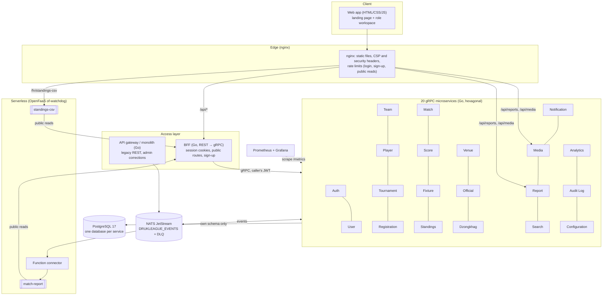
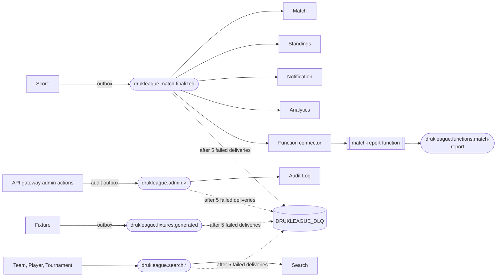
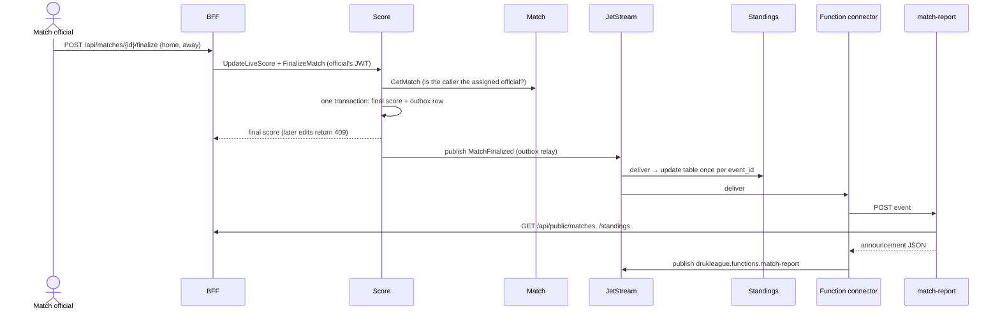
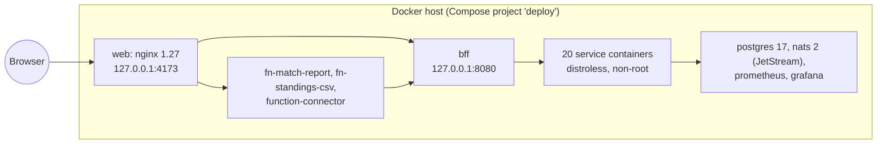

# DrukLeague — Architecture

Version 28 Nov 2026. This describes the system as implemented in this repository; the dependencies below are taken from `deploy/docker-compose.yml` and the service code, not from the plan. The diagrams use Mermaid and render on GitHub.

## 1. System overview

- **Synchronous calls** use gRPC with versioned Protocol Buffer contracts (`proto/`, checked by Buf lint/breaking in CI). Every call carries a deadline, retries safe reads with backoff, and passes through a per-target circuit breaker (`packages/servicekit`).
- **Authentication:** the Auth service issues HS256 JWTs (30-minute access tokens with rotating refresh tokens). The BFF stores them in HttpOnly, SameSite=Strict cookies and forwards the caller's token, so **every service checks the caller's role itself**. Public routes and viewer sign-up use a short-lived service token instead and never forward browser credentials.
- **Data ownership:** each service owns one PostgreSQL database (for example `score_service` or `registration_service`). Nothing reads another service's database; cross-service data travels over gRPC or events.

## 2. Service responsibilities and dependencies

| Service | Owns | Calls (gRPC) | Events |
|---|---|---|---|
| Auth | sessions, refresh tokens | User | — |
| User | accounts, roles, password hashes | — | — |
| Team | teams, managers | — | publishes search documents |
| Player | squads | Team | publishes search documents |
| Tournament | tournaments | — | publishes search documents |
| Registration | tournament entries (pending/approved/rejected) | Team, Tournament | — |
| Fixture | schedules, knockout plans | Tournament, Venue, Registration, Match, Standings | publishes `FixturesGenerated` |
| Match | fixtures, official assignment | — | consumes `MatchFinalized` |
| Score | live and final scores (immutable once final) | Match | publishes `MatchFinalized` via a transactional outbox |
| Standings | league tables | Team | consumes `MatchFinalized` (idempotent by `event_id`) |
| Venue | grounds per dzongkhag | Dzongkhag | — |
| Official | assignments | Match | — |
| Dzongkhag | the 20 dzongkhags | — | — |
| Notification | notification records | Team | consumes `MatchFinalized` |
| Media | uploads (HTTP + gRPC) | — | — |
| Report | generated reports (HTTP) | — | — |
| Search | search index | — | consumes search documents |
| Analytics | dashboard facts | Tournament, Team, Match, Player, Registration | consumes `MatchFinalized` |
| Audit Log | admin action history | — | consumes `drukleague.admin.>` |
| Configuration | allow-listed runtime settings | — | — |

The **BFF** calls Auth, User, Tournament, Team, Registration, Player, Venue, Match, Score, Fixture, Standings and Official.

## 3. Event flow

Delivery is at-least-once: messages carry stable ids (`Nats-Msg-Id`) for publisher de-duplication, consumers are durable and idempotent, redelivery backs off, and poison messages move to the dead-letter stream (30-day retention) where `tools/event-admin` can inspect and replay them.

## 4. Key workflow: finalising a result

## 5. Deployment view

- Every image builds from `services/service-builder` (Go 1.26) into `gcr.io/distroless/static-debian12:nonroot`. CI builds all images and fails on CRITICAL Trivy findings.
- Ports are bound to `127.0.0.1` only. Secrets come from `deploy/.env`, which is git-ignored.
- The deployment is local (Docker Compose), as scoped in the proposal ("production-scale cloud deployment" is out of scope). The functions are also deployable to OpenFaaS/faasd with `functions/stack.yml`.

## 6. Quality attributes and where they are handled

| Attribute | Mechanism | Location |
|---|---|---|
| Security | JWT + role checks in every service, HttpOnly cookies, CSP, rate limits, sign-up fixed to Viewer, formula-safe CSV | `servicekit/auth.go`, each `internal/app`, `deploy/nginx*.conf`, `services/bff` |
| Integrity | the assigned official only; final scores immutable; outbox in the same transaction | `services/score`, `services/match` |
| Resilience | deadlines, retry with backoff, circuit breaker, durable consumers, DLQ, graceful degradation in BFF lists and functions | `packages/servicekit`, `packages/eventkit` |
| Observability | request ids end to end, Prometheus metrics, Grafana dashboards | `servicekit/metrics.go`, `monitoring/` |
| Maintainability | hexagonal layout per service (domain, app, ports, adapters) | `services/*/internal` |
