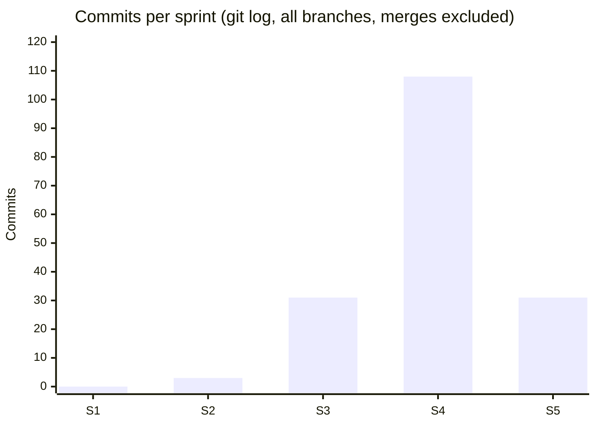

# SWE303 — Project Management Plan

**Project:** DrukLeague, an inter-dzongkhag sports tournament platform
**Version:** 1.0, 28 Nov 2026
**Team:** Tandin Wangchuk, Norbu Dendup, Sonam Choki, Namgay Lhamo
**Tutors:** Mr. Nima Yoezer (SWE303), Mr. Pema Namgay (WEB303, SWE302)

This plan ties together the project's management documents. Every figure below can be traced to the repository, CI or the Jira board (`SCRUM`). Where something is a plan or a draft rather than a record, it says so.

| Area | Document |
|---|---|
| Scope baseline and objectives | [project-charter.md](project-charter.md), proposal (`Group7_DrukLeague_Project_Proposal.pdf`) |
| Stakeholders | [stakeholder-analysis.md](stakeholder-analysis.md) |
| Work breakdown | [wbs.md](wbs.md) |
| Architecture decisions | [architecture.md](architecture.md), [architecture-decision-mvp.md](architecture-decision-mvp.md) |
| Risk management | [risk-register.md](risk-register.md) |
| Quality management | [quality-plan.md](quality-plan.md), [swe302-test-plan.md](swe302-test-plan.md), [test-execution-report.md](test-execution-report.md) |
| Change control | [change-control.md](change-control.md) |
| Sprint records | [sprint-evidence.md](sprint-evidence.md) |
| Lessons learned | [lessons-learned.md](lessons-learned.md) |
| Status and decision log | `progress.md` (dated entries) |

## 1. Lifecycle and process

The team uses **Scrum** with eight two-week sprints (proposal §4B). Each sprint has planning, implementation with unit tests, code review through GitHub pull requests, integration, review and retrospective. Work is incremental: each service is designed, tested and merged on its own, then integrated through the BFF and events.

**Definition of Done** (applies to every Jira story):
1. Code is merged into `development` through a pull request.
2. All required CI checks pass: gofmt, go vet and build, the per-service 80% coverage gate, Buf contract checks, gosec/govulncheck, image build and Trivy scan, the frontend role-permission tests, the k6 smoke test and the audit end-to-end test.
3. Acceptance evidence is recorded in `progress.md` (what was run, on which revision, and the result).
4. Any open defect is logged in [defect-log.md](defect-log.md).

## 2. Organisation and responsibilities (RACI)

R = responsible (does the work), A = accountable (signs off), C = consulted, I = informed. Allocation follows the proposal (§4F). On 27 Nov 2026 Norbu took over Namgay's frontend work; this is recorded in the change log.

| Deliverable | Tandin | Norbu | Sonam | Namgay |
|---|:-:|:-:|:-:|:-:|
| Contracts (Protocol Buffers) and database design | A/R | C | C | I |
| Auth, User, Team, Player, Tournament, Registration services | A/R | C | I | I |
| Match, Score, Fixture, Standings, Venue services; NATS outbox and events | C | A/R | I | I |
| Serverless functions and connector | I | A/R | I | C |
| Official, Dzongkhag, Notification, Audit Log, Media services | I | C | A/R | I |
| Report, Search, Analytics, Configuration services | I | C | I | A/R |
| API gateway and BFF | C | A/R | R | I |
| Web frontend (landing page, role workspace) | I | A/R (from 27 Nov) | C | R (to 27 Nov) |
| CI/CD pipeline and test automation | C | C | C | A/R |
| Test plan, traceability matrix, defect log | C | R | C | A/R |
| Project documents and sprint tracking (Jira) | C | R | C | A/R |
| Docker Compose deployment | I | A/R | C | R |
| Final report and presentation | R | R | R | A/R |

## 3. Scope management

- **Baseline:** 20 microservices, an API gateway, a BFF, serverless functions, a responsive web app, PostgreSQL per service, NATS JetStream, automated tests and CI quality gates (proposal §2A). Out of scope: production cloud hosting, payments, real SMS, native mobile apps (proposal §2A).
- **Decomposition:** [wbs.md](wbs.md) breaks this into 12 work packages, each mapped to a Jira epic or story.
- **Change control:** a change to scope, schedule or a deliverable is logged in [change-control.md](change-control.md) with its reason and impact before work starts. Examples: payment removed from scope; registration routes added to the BFF so that fixtures only include approved teams; serverless functions delivered as OpenFaaS-compatible containers because faasd cannot run on the team's Windows machines.

## 4. Schedule management

| Milestone (proposal §5A) | Planned | Status on 28 Nov 2026 | Evidence |
|---|---|---|---|
| M1 Foundation and architecture | Sprint 1 | Done | Compose, CI, protobuf contracts, `docs/architecture.md` |
| M2 Auth, users, gateway, BFF | Sprint 2 | Done | `services/auth`, `services/user`, `services/api-gateway`, `services/bff` |
| M3 Teams, players, tournaments | Sprint 3 | Done | `services/team`, `player`, `tournament`, `registration` |
| M4 Match, fixture, score, standings | Sprint 4 | Done | `services/match`, `score`, `fixture`, `standings`; live acceptance in `progress.md` §59 |
| M5 Venue, official, notification, audit | Sprint 5 | Done | `services/venue`, `official`, `notification`, `audit-log` |
| M6 Supporting services | Sprint 6 | Done | `services/media`, `report`, `search`, `analytics`, `configuration` |
| M7 Integration, events, serverless, observability | Sprint 7 | Done, with OpenTelemetry deferred | `functions/`, `packages/eventkit`, Prometheus/Grafana |
| M8 Testing, documentation, final demo | Sprint 8 | In progress | this plan, [test-execution-report.md](test-execution-report.md); presentation in Weeks 14–15 |

**Schedule variance.** The repository's first commit is dated 12 Oct 2026. Delivery then concentrated in Sprints 4 and 5, so the plan's even spread did not happen in practice (see §5). The project end date is **3 Dec 2026**. The Jira sprints still run to 11 Jan 2027, and re-baselining them to end on 3 Dec is pending the team's approval of the prepared Jira plan.

## 5. Estimation and progress measurement

**Method.** Each sprint's scope was sized from the proposal's work packages (one service is roughly one developer for one sprint, including its tests), within a capacity of four developers for two weeks. Throughput is measured with **merged pull requests** and **commits**, because both can be checked in Git.

| Sprint (Jira dates) | Commits | Merged PRs |
|---|---:|---:|
| S1 21 Sep–5 Oct | 0 | 0 |
| S2 5–19 Oct | 3 | 0 |
| S3 19 Oct–2 Nov | 31 | 0 |
| S4 2–16 Nov | 108 | 32 |
| S5 16–30 Nov (to 28 Nov) | 31 | 17 |

**Reading the data.** Work started late and peaked in Sprint 4, when the PR workflow with required CI checks was introduced (all 49 PRs fall in S4–S5). Commit authors on 28 Nov 2026: Norbu-d 66, Namgay Lhamo 66 (two identities), sonamchokss 40, and one automated agent. Tandin's services exist in the repository, but no commits are attributed to his own Git identity. This is a known risk to individual-contribution evidence (risk R13).

## 6. Resource management

- **People:** four student developers and two tutors.
- **Hardware:** developer laptops running Docker Desktop. Running about 30 containers stretches them: a full parallel image build failed once under load on 28 Nov, and the fix was to build with `COMPOSE_PARALLEL_LIMIT=4`.
- **Software (all free):** Go 1.26, PostgreSQL 17, NATS 2 JetStream, Docker Compose, Buf, GitHub and GitHub Actions, Jira Cloud (free tier), Playwright, k6, Trivy, gosec, govulncheck, OWASP ZAP, Prometheus and Grafana, and the OpenFaaS of-watchdog.

## 7. Communication management

| Audience | Information | Channel | When | Owner |
|---|---|---|---|---|
| Team | Sprint goal, backlog, task status | Jira board `SCRUM` | Sprint planning; updated as work moves | Namgay |
| Team | Code changes, review comments, CI results | GitHub pull requests to `development` | Every change | Author and reviewer |
| Team and tutors | Decisions, acceptance evidence, open issues | `progress.md` (dated, numbered entries) | After each piece of work | Whoever did the work |
| Tutors | Scope, plan and risks | Proposal (6 Oct 2026), this plan | At submission | Namgay |
| Tutors and class | Demo, results, lessons | Final presentation | Weeks 14–15 | All |
| Team | Blockers, hand-overs (for example the 27 Nov frontend hand-over) | Team chat, then recorded in `progress.md` and Jira | As they happen | Person handing over |

Rules: secrets (`deploy/.env`) are never shared in any channel. Decisions that change scope go to the change log before the work starts.

## 8. Monitoring and control

- **Quality gates:** CI blocks a merge when a check fails (see the [quality plan](quality-plan.md)).
- **Progress:** Jira board status plus the git and PR measures in §5.
- **Risk:** the [risk register](risk-register.md) is reviewed at sprint review; the 28 Nov review updated R1, R7 and R9 and added R13–R15.
- **Defects:** logged with severity in [defect-log.md](defect-log.md). P1 defects block the demo.
- **Acceptance:** real-stack acceptance runs (36 + 8 checks on 28 Nov) are recorded in `progress.md` §59 and the [test execution report](test-execution-report.md).

## 9. Closure

Before the final presentation: freeze `development`, rebuild every image from the frozen commit, run the full CI and acceptance suite, record the final results in the test execution report, close the Jira sprints, and hold the final retrospective. Its outcomes complete [lessons-learned.md](lessons-learned.md).
