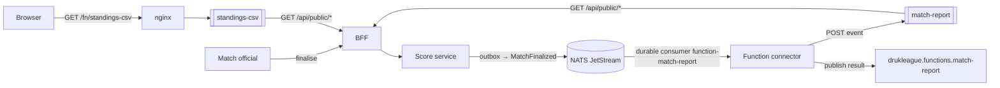

# Serverless functions

DrukLeague's serverless part follows the OpenFaaS model: each function is a small, stateless HTTP handler packaged with the official OpenFaaS **of-watchdog** (`mode=http`). Events reach functions through a **connector**, the same pattern as the OpenFaaS NATS connector, so functions never talk to NATS or a database themselves.

| Function | Trigger | What it does | Reads |
|---|---|---|---|
| `match-report` | Event: `drukleague.match.finalized` (via the connector) | Turns a finalised result into an announcement: headline, venue, verdict and the top three of the table. The result is published on `drukleague.functions.match-report`. | BFF public routes |
| `standings-csv` | HTTP: `GET /fn/standings-csv?tournament_id=<uuid>` (nginx) | Returns the ranked league table as a CSV download, with spreadsheet-formula cells neutralised. Used by the web app's **Standings → Download CSV** button. | BFF public routes |



## Design rules

- **Stateless:** no database, no local state. All data comes from the BFF's read-only public routes, so a function can be scaled to any number of replicas or restarted at any time.
- **Least privilege:** the functions hold no credentials. The public routes strip account ids and cannot write.
- **Delivery:** the connector uses an eventkit durable pull consumer. A network failure, a 5xx or a 429 from the function is retried with backoff. A 4xx (a malformed event) is permanent and goes to the dead-letter stream (`DRUKLEAGUE_DLQ`). Each event is processed once per consumer; a new consumer replays the stream from the start.
- **Graceful degradation:** if the BFF is unavailable, `match-report` still returns the score with generic names, and `standings-csv` returns `502` with a clear message.

## Running locally (Docker Compose)

faasd needs Linux and containerd, so it does not run on the Windows/Docker Desktop machines used for the demo. The same images run under Compose instead:

```bash
docker compose -f deploy/docker-compose.yml up -d --build fn-match-report fn-standings-csv function-connector web
docker logs -f deploy-function-connector-1      # one match-report line per finalised match
curl "http://127.0.0.1:4173/fn/standings-csv?tournament_id=<id>"
```

## Deploying to OpenFaaS or faasd

`stack.yml` uses the `dockerfile` language, so no template download is needed:

```bash
faas-cli up -f functions/stack.yml          # build, push and deploy both functions
```

Then point the connector at the gateway: `FUNCTION_URL=http://<gateway>:8080/function/match-report`.

## Tests

Each function and the connector are separate Go modules included in CI (`scripts/ci-go.sh`, `scripts/coverage.sh`, gofmt and image build + Trivy scan). Coverage on 28 Nov 2026: match-report 91.6%, standings-csv 90.5%, connector `internal/` 100%.
